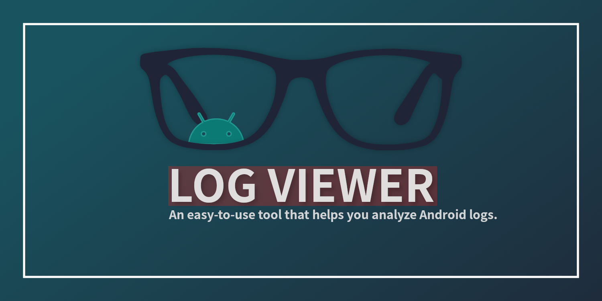
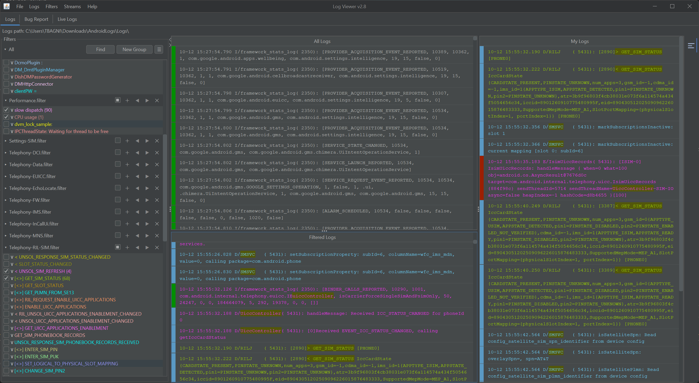
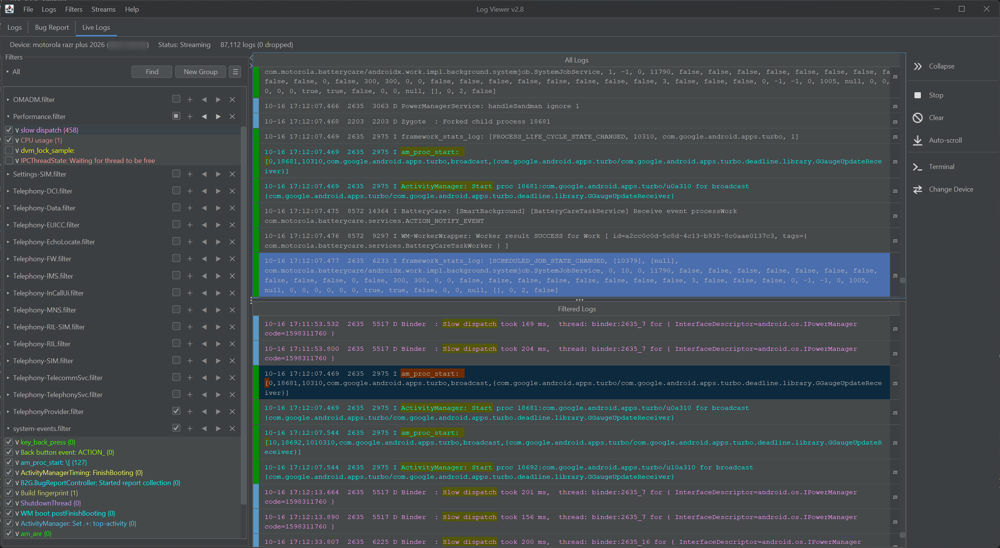
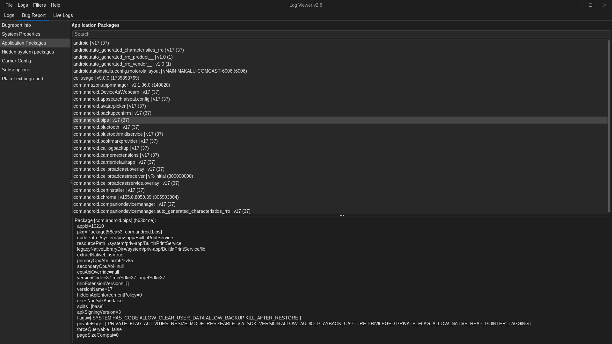

<div align="center">
  

  # LogViewer

  **A fast, visual log analysis tool and live Logcat streamer for Android developers.**

  [](https://github.com/tibagni/LogViewer/releases/latest)
  [](https://github.com/tibagni/LogViewer/actions/workflows/main.yml)
  [](https://coveralls.io/github/tibagni/LogViewer?branch=master)
  [](https://www.oracle.com/java/)
  [](https://opensource.org/licenses/MIT)

  <br/>

  [Documentation](https://tibagni.github.io/LogViewer/) • [Download](https://github.com/tibagni/LogViewer/releases/latest) • [Features](#features) • [Quick Start](#quick-start) • [Shortcuts](#shortcuts)

  <br/><br/>

  <a href="docs/images/main_view.png">
    
  </a>
</div>

---

## Why LogViewer?

Analyzing raw Android logs, multi-file bugreports, or live logcat bursts can quickly become overwhelming in standard text editors or IDE windows. LogViewer was built to solve this:

* 🎨 **Multi-Color Filter Canvas**: Create regex and keyword filters, assign distinct colors to different components (for example: Bluetooth in blue, Audio in orange, Crash in red), and view matches side by side in real time without losing the surrounding log context.
* 📱 **Integrated Live Logcat Streaming**: Connect your device over USB or Wi-Fi, select log stream buffers (`main`, `system`, `events`, `crash`, `radio`, `kernel`), and stream live with auto-reconnection and single-click device terminals.
* ⚡ **Optimized for Heavy Bugreports**: Open and chronologically merge multi-file logs and 100MB+ bugreports instantly with parallel indexing and memory streaming.
* 🤖 **Android Bugreport Intelligence**: Inspect device properties (`getprop`), installed packages, hidden system services, carrier configs, and subscriptions with dedicated UI inspectors.
* 🌗 **Modern Look and Feel**: Clean Light and Dark themes, customizable typography, and full keyboard navigation.

---

<a id="quick-start"></a>
## 🚀 Quick Start

### 1. Download & Run (No build required)
LogViewer is multiplatform (macOS, Linux, Windows) and packaged as a standalone executable JAR:

👉 **[Download the Latest Release (`LogViewer-all.jar`)](https://github.com/tibagni/LogViewer/releases/latest)**

Run it with a double-click or from your terminal (requires Java 8 or newer):
```bash
java -jar LogViewer-*-all.jar
```

### 2. Open Logs or Bugreports
* **Drag & Drop**: Drop `.txt`, `.log`, or `.zip` bugreport files directly into the window.
* **CLI Arguments**: Pass log paths directly when launching:
  ```bash
  java -jar LogViewer-*-all.jar bugreport.txt main.log radio.log
  ```
* **File Menu**: Select `Logs > Open Logs` to pick multiple log files at once.

### 3. Stream Live Device Logs
Switch to the **Live Logs** tab, select your connected Android device, choose your desired buffers (`main`, `system`, `events`, `radio`, etc.), and click **Start Streaming**.

---

<a id="features"></a>
## ✨ Features

| Feature | Description |
| :--- | :--- |
| **Multi-File Log Merging** | Open and chronologically merge multiple `.log`, `.txt`, and `.zip` bugreport files at once. |
| **Live ADB Streamer** | Direct integration with `adb logcat`: manage connected devices, select stream buffers (`main`, `system`, `events`, `crash`, `radio`, `kernel`), restart server, and launch root device shells. |
| **Color-Coded Filtering** | Assign individual colors to regex and keyword filters to instantly distinguish which subsystem generated each log line. |
| **Filter Groups & Sharing** | Organize filters into named groups/tabs, save filter sets to reusable `.filter` files, and share them across your team. |
| **Dual-Pane Synchronized Views** | The **Filtered Logs** pane displays matched lines while the **All Logs** pane preserves chronological timeline context. Double-click any line to navigate between views. |
| **"My Logs" Bookmarking** | Pin and curate critical log entries into a dedicated "My Logs" pane to assemble an incident investigation timeline. |
| **Quick Context Actions** | Right-click any log line to "Filter by PID", inspect detailed multi-line text (`Cmd+I` / `Ctrl+I`), or bookmark directly into "My Logs". |
| **Elapsed Time Measurement** | Select any two log lines and right-click to instantly inspect the elapsed duration or copy a formatted incident snippet (both log lines with time delta) for bug reports and tickets. |
| **Global Filter Search** | Search across all open filter groups using the global find dialog (`Cmd+Shift+F` / `Ctrl+Shift+F`). |
| **Advanced In-Table Search** | In-table search with real-time debounce, match count tracking, highlight tracking, and reverse search (`Shift+Enter` / `Shift+F3`). |
| **Log Stream Badges** | Visual badges (`[main]`, `[system]`, `[events]`, `[radio]`, `[kernel]`) clearly differentiate sources in mixed live streams. |
| **Time Limiting** | Narrow down investigations by setting timestamp boundaries to ignore noisy logs before or after an incident. |
| **Bugreport Intelligence** | Dedicated inspectors for device properties (`getprop`), installed application packages, hidden system packages, carrier configs, and subscriptions. |
| **High-Performance Architecture** | Parallel timestamp sorting, memory-efficient streaming, fast indexing, and zero-drop live buffer handling 80k+ lines effortlessly. |
| **Modern Themes & Typography** | Clean Light and Dark themes, customizable monospaced fonts, font size scaling, and bold rendering. |
| **Multi-Language Support** | Native support for English and Brazilian Portuguese (`pt-BR`). |

---

## 📸 Showcase

### Live Logcat Streaming & Device Management
<div align="center">
  <a href="docs/images/live_logs.png">
    
  </a>
  <p><em>Real-time streaming from connected Android devices with live filtering, buffer selection, and single-click device terminals</em></p>
</div>

### Bug Report Analysis
<div align="center">
  <a href="docs/images/bugreport_app_view.png">
    
  </a>
  <p><em>Inspect Android application packages, system properties, carrier configurations, and services</em></p>
</div>

---

<a id="shortcuts"></a>
<a id="keyboard-shortcuts"></a>
## ⌨ Keyboard Shortcuts

| Shortcut (macOS / Linux & Windows) | Action |
| :--- | :--- |
| `Cmd+O` / `Ctrl+O` | Open log files |
| `Cmd+W` / `Ctrl+W` | Close currently opened logs |
| `Cmd+Shift+F` / `Ctrl+Shift+F` | Search across all filters |
| `Cmd+F` / `Ctrl+F` | Find in active log table |
| `F3` / `Shift+F3` | Next / previous search match |
| `Enter` / `Shift+Enter` | Next / previous search match in find bar |
| `Space` | Toggle selected filter(s) on/off |
| `Cmd+I` / `Ctrl+I` | Inspect selected log line in detail |
| `Cmd+1` / `Ctrl+1` | Switch to Main Logs tab |
| `Cmd+2` / `Ctrl+2` | Switch to Bug Report tab |
| `Cmd+3` / `Ctrl+3` | Switch to Live Logs tab |

---

## 🛠️ Tech Stack & Requirements

* **Language**: Kotlin & Java
* **UI Framework**: Swing (FlatLaf)
* **Build System**: Gradle (wrapper `./gradlew` included)
* **Java**: JDK 8 or later (tested on Java 8, 11, 17, and 21)
* **ADB** *(Optional)*: [Android Platform Tools](https://developer.android.com/tools/releases/platform-tools) for live logcat streaming and terminal shell

---

## 💻 Developer & Contributor Guide

### 1. Building from Source
Clone the repository and build the project using Gradle:
```bash
# Clone the repository
git clone https://github.com/tibagni/LogViewer.git
cd LogViewer

# Build the project
./gradlew build
```

### 2. Running Unit Tests
You can run the full test suite from your terminal or directly inside IntelliJ IDEA:
* **Command line**:
  ```bash
  ./gradlew test
  ```
* **IntelliJ IDEA**: Right-click the `src/test` directory in the Project view and select **Run 'All Tests'**.

### 3. Packaging Executable JAR
To create a standalone fat JAR containing all dependencies:
```bash
./gradlew shadowJar
```
The output executable JAR will be located at `build/libs/LogViewer-{version}-all.jar`. You can run it directly:
```bash
java -jar build/libs/LogViewer-*-all.jar
```

### 4. Updating App Version
To increase the application version, update `app.properties`:
* The configuration file is located at `src/main/resources/properties/app.properties`. A symbolic link (`app.properties`) is also available in the repository root for convenience.
* You can edit this file manually, or use the version increment script described below.

### 5. Creating a Pull Request
The repository includes a helper script (`./scripts/pr-workflow.sh`) to automate branch creation, pushing, and PR management (requires [GitHub CLI](https://cli.github.com/)):
```bash
# Create a new branch, push, open PR, and stay on branch to continue iterating:
./scripts/pr-workflow.sh <feature-branch-name>

# If already on a feature branch (or to be prompted when on master):
./scripts/pr-workflow.sh

# Quick mode: create PR, immediately switch back to master, and delete local branch:
./scripts/pr-workflow.sh --quick <branch-name>

# Open PR and watch CI / AI review checks live in terminal:
./scripts/pr-workflow.sh -w
```
By default, the script pushes your commits, opens a PR targeting `master` (using your commit messages for the title and description), and keeps you on the branch so you can iterate on code review feedback. If a PR is already open for that branch, running the script pushes your latest updates to the existing PR.

### 6. Deploying a New Release
Deployments are handled via the [Release Deploy GitHub Action](https://github.com/tibagni/LogViewer/actions/workflows/deploy.yml):
1. Run the version increment helper script:
   ```bash
   ./scripts/inc-ver-workflow.sh <new-version>
   # Example: ./scripts/inc-ver-workflow.sh 2.8
   ```
   This validates the new version number, updates `app.properties`, creates the commit and tag, and pushes them to GitHub.
2. On GitHub, navigate to the **Actions** tab ➔ **Release Deploy**.
3. Click **Run workflow**, enter the tag name (e.g. `2.8`), and submit. The workflow will automatically build the standalone fat JAR, generate release notes, and publish the GitHub Release with the binary attached.

### 7. Generating Documentation Screenshots
To regenerate all screenshots used in `README.md` and the [User Guide (`gh-pages`)](https://tibagni.github.io/LogViewer/) after UI changes:
```bash
# Generate into docs/images/ (default):
./gradlew generateScreenshots

# Or specify a custom output directory:
./gradlew generateScreenshots -PoutputDir=/path/to/output
```
The task renders the live Swing UI off-screen using your currently configured theme, accent color, and log font settings.

---

## 📄 License
LogViewer is open source software released under the [MIT License](LICENSE).
