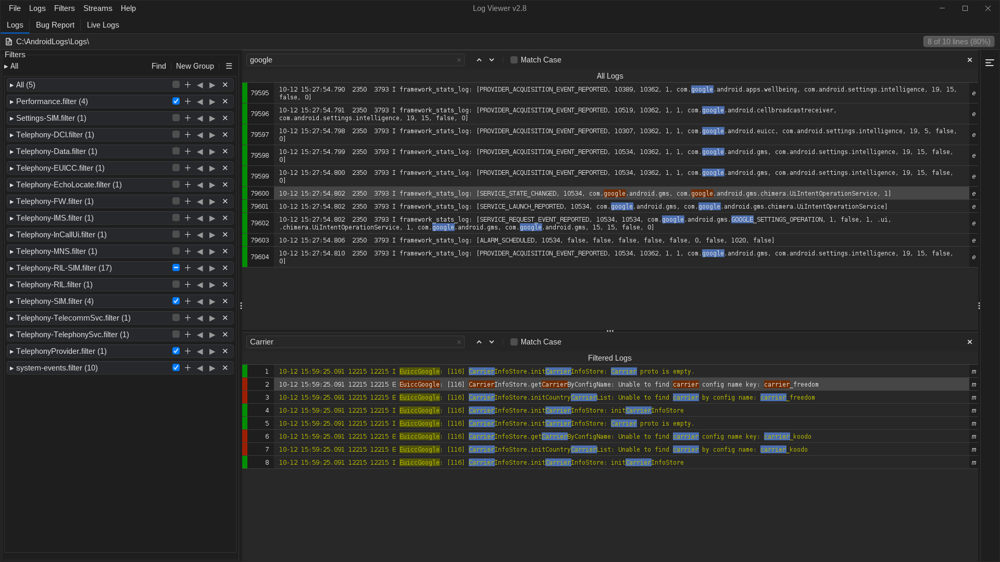
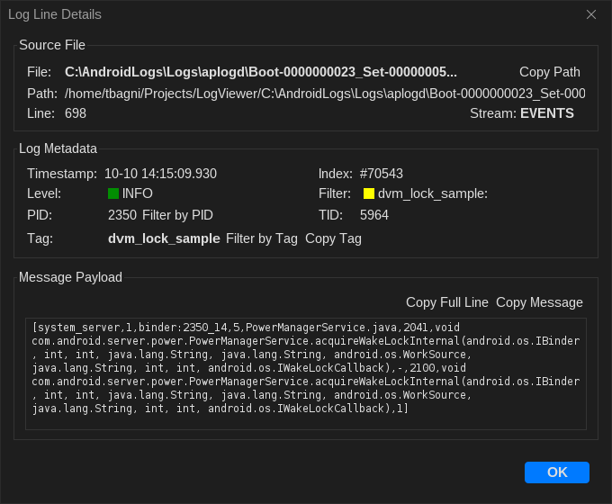
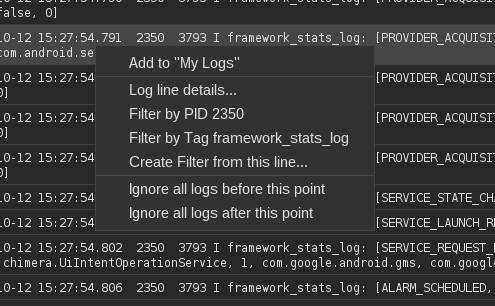
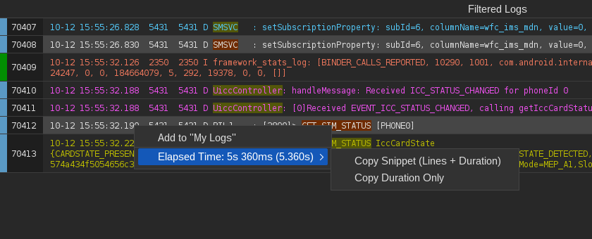

# Viewing & Analyzing Logs

At its core, LogViewer is designed to give you high-speed visibility into complex Android logs while preserving full chronological context.

---

## Loading Logs

You can load logs into LogViewer through any of the following methods:

* **Drag and Drop**: Drag one or more `.txt`, `.log`, or `.zip` bugreport files directly into the LogViewer window.
* **File Menu**: Go to `Logs > Open Logs` or press ++cmd+o++ (macOS) / ++ctrl+o++ (Linux & Windows).
* **Command Line**: Pass log paths when launching from your terminal:
  ```bash
  java -jar LogViewer-*-all.jar bugreport.txt main.log radio.log
  ```

---

## The Synchronized Dual-Pane View

When logs and filters are active, LogViewer divides the workspace into two synchronized log tables:

[](images/main_view.png)

1. **All Logs View (Top/Left)**: Displays every raw log entry loaded across all files and streams in chronological order.
2. **Filtered Logs View (Bottom/Right)**: Displays only the log lines that match your active filters, color-coded by filter rule.

### Context Preservation
When triaging an issue, seeing isolated filter matches alone can cause you to miss what the system was doing immediately before or after a crash. 

Whenever you click a line in the **Filtered Logs** view, LogViewer instantly scrolls to and highlights that exact log line in the **All Logs** view, allowing you to seamlessly inspect surrounding system activity.

---

## In-Table Search

Every log table includes a high-performance, debounced in-table search engine:

[](images/search-bar.png)

* **Open Search**: Press ++cmd+f++ (macOS) or ++ctrl+f++ (Linux & Windows) while focused on any log table.
* **Type to Filter**: Search terms are evaluated in real time without freezing the UI.
* **Forward Navigation**: Press ++enter++ or ++f3++ to jump to the next matching line.
* **Reverse Navigation**: Press ++shift+enter++ or ++shift+f3++ to jump backward to the previous match.
* **Match Statistics**: The search bar indicates current position and total matches found (`x of y`).
* **Dismiss**: Press ++escape++ to close the search bar and return focus to the log table.

---

## Detailed Line Inspector

Log entries such as Java crash traces, Binder dumps, or JSON payloads often contain long multiline messages that get truncated in a single-row table.

[](images/line-inspector.png)

* Press ++cmd+i++ (macOS) / ++ctrl+i++ (Linux & Windows) or right-click and choose **Inspect**.
* The inspector dialog presents a formatted breakdown of the selected log entry:
    * **Timestamp**: Millisecond-accurate event time.
    * **Priority**: Verbose, Debug, Info, Warning, Error, or Assert.
    * **Tag**: Originating logging component or class.
    * **PID & TID**: Originating Process ID and Thread ID.
    * **Message**: Full, word-wrapped multiline message text with one-click copy.

---

## Context Menu & Quick Actions

Right-clicking on any log line provides instant contextual actions:

[](images/log-context-menu.png)

* **Filter by PID / Filter by Tag**: Automatically generates and applies a new filter for the selected log line's process ID or tag, instantly isolating all logs emitted by that specific process or component.
* **Create Filter from this line...**: Opens the Filter Editor pre-filled with the selected line's text and tags.
* **Add to My Logs**: Pins the log entry into the [My Logs](my-logs.md) bookmark list.
* **Inspect Line**: Opens the detailed inspector dialog.
* **Copy**: Copies the selected log line(s) to your clipboard.
* **Ignore Logs Before / After**: Sets active [Time Window](limiting-time-window.md) boundaries.

---

## Measuring Elapsed Time Between Log Lines

When investigating performance bottlenecks, ANRs, or slow startup sequences, you can measure the exact time delta between any two log entries:

[](images/elapsed-time-menu.png)

1. Select any **two log lines** in **All Logs**, **Filtered Logs**, or **My Logs** (using ++cmd++ / ++ctrl++ + click, or ++shift++ + click for adjacent lines).
2. Right-click to immediately see the calculated **Elapsed Time** between the two timestamps in the context menu.
3. Hover over **Elapsed Time** to copy the result to your clipboard:
    * **Copy Snippet (Lines + Duration)**: Copies both log lines along with the formatted elapsed time delta—ideal for pasting directly into bug reports, pull requests, or issue tickets.
    * **Copy Duration Only**: Copies just the formatted duration string (e.g., `5s 360ms (5.360s)`).
