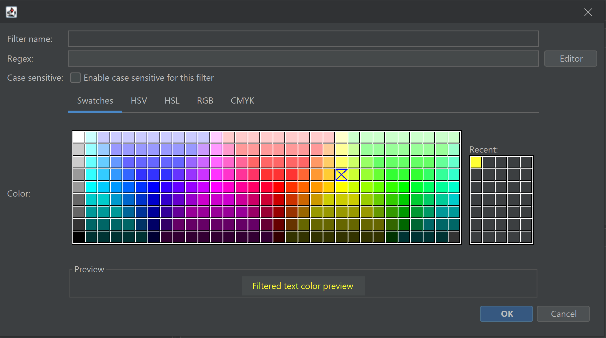
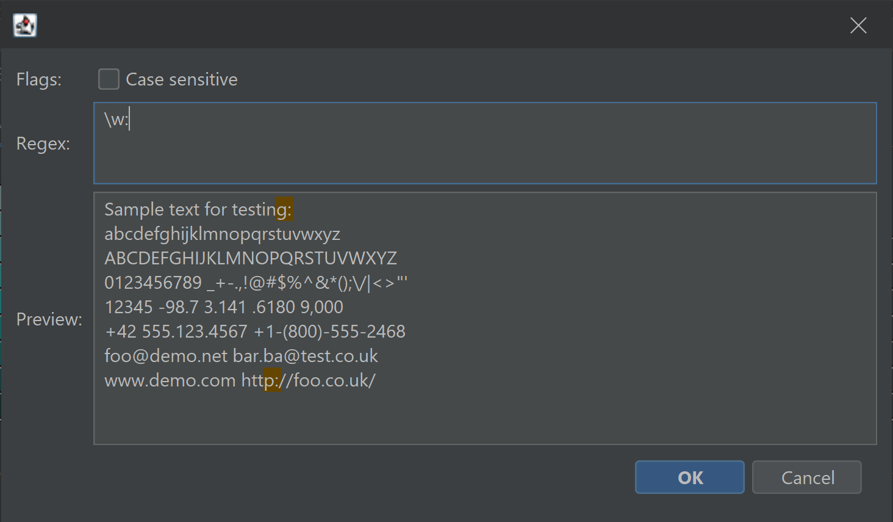

# Filter & Regex Editor

LogViewer gives you complete control over how filters match log messages, how they are colored, and how complex your query expressions can be.

---

## Filter Editor

When creating or editing a filter (double-click a filter or right-click and choose **Edit**), you can configure:

* **Filter Name**: A descriptive label for the filter (e.g. `ActivityManager`, `Fatal Exception`, or `RIL Requests`). If left blank or simple, the query itself can serve as the label.
* **Color Picker**: Choose a distinct background or foreground color for matching lines. Assigning distinct hues (for example: red for errors, cyan for network, yellow for warnings) makes scanning logs effortless.
* **Case Sensitivity**: Toggle whether matching respects letter casing.
* **Regex Toggle**: Enable or disable regular expression parsing.

---

## Integrated Regex Editor

Creating complex regular expressions can be error-prone. LogViewer includes an interactive **Regex Editor** to test and preview queries before saving:

### Key Features
* **Live Match Highlighting**: Type your expression in the **Regex** field, and sample text in the test area below will highlight matching segments in real time.
* **Syntax Error Feedback**: If your regular expression has invalid syntax, the input field turns red immediately to warn you before saving.
* **Test with Real Logs**: Paste actual log lines from your bugreport into the test area to verify that your pattern catches edge cases.

---

## Common Android Regex Patterns

Here are several useful regular expression patterns commonly used in LogViewer:

| Pattern | Target Matches |
| :--- | :--- |
| `(?i)fatal\|exception\|crash` | Any line containing fatal errors, uncaught exceptions, or crash traces (case-insensitive). |
| `\bActivityTaskManager\b` | Specific Android framework system service tags. |
| `Displayed\s+com\.example\.app` | App launch completion and cold-start latency measurements. |
| `ANR in\s+` | Application Not Responding (ANR) trace triggers. |
| `(?<=pid\s)\d+` | Process ID number extraction. |
