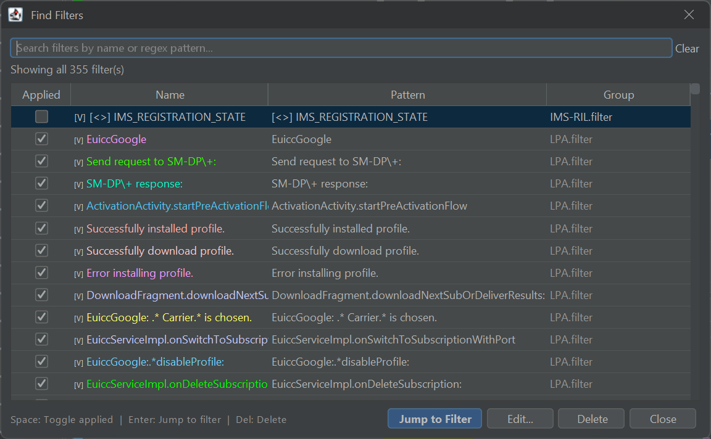
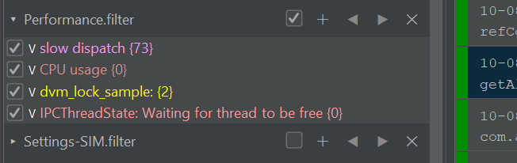

# Filters & Groups

Filters are the core of LogViewer. They allow you to sift through millions of log lines and isolate exactly what you need without losing the broader context of system events.

---

## Organizing Filters into Groups

You can organize filters into logical groups (for example: *Telephony*, *Bluetooth*, *Audio*, *System Crash*, or *App Startup*).

* **New Group**: Click the **New group** button above the filter panel.
* **Add Filter**: Click the **+** button on any group header to add a new filter to that specific group.
* **Reorder**: Drag and drop filters within a group to adjust their evaluation and display order.
* **Save & Share**: Groups can be saved to standalone filter files (`.filter` / `.reg`) and shared with teammates or committed alongside project repositories.

---

## Applying Filters

* **Toggle Single Filter**: Click the checkbox next to the filter name, or select the filter and press ++space++.
* **Toggle Entire Group**: Click the checkbox next to the group header to enable or disable all filters in that group simultaneously.

---

## Global Filter Search

When managing dozens of specialized filters across multiple groups, you can quickly locate and toggle any filter using keyboard search:

* Press ++cmd+shift+f++ (macOS) or ++ctrl+shift+f++ (Linux & Windows).
* Type keywords to filter the list instantly across all groups.
* Use arrow keys and press ++space++ or ++enter++ to activate the filter.

---

## Filter Statistics & Occurrence Navigation

When a filter is applied, LogViewer displays real-time match statistics and navigation shortcuts directly beside the filter name:

In the example above (`ClassLoader {905} ❙ ← (,) / → (.)`):
* **`{905}`**: The total number of matching log lines found in the active log set.
* **`← (,)`**: Press ++comma++ to jump backward to the previous matching occurrence in the All Logs view.
* **`→ (.)`**: Press ++period++ to jump forward to the next matching occurrence in the All Logs view.
* **Navigation Buttons**: Click the `<` and `>` buttons to step through matches sequentially.

---

## Creating Filters from a Log Line

A rapid way to create a filter is directly from the log table:
1. Select any log line in the All Logs view.
2. Right-click and choose **Create Filter from this line...**.
3. LogViewer will open the Filter Editor pre-populated with the exact text or tags from that log line, allowing you to fine-tune your query.

---

## Bookmarking Lines

Need to save specific lines across different filters? Check out the dedicated **["My Logs" Bookmarks](my-logs.md)** guide.
