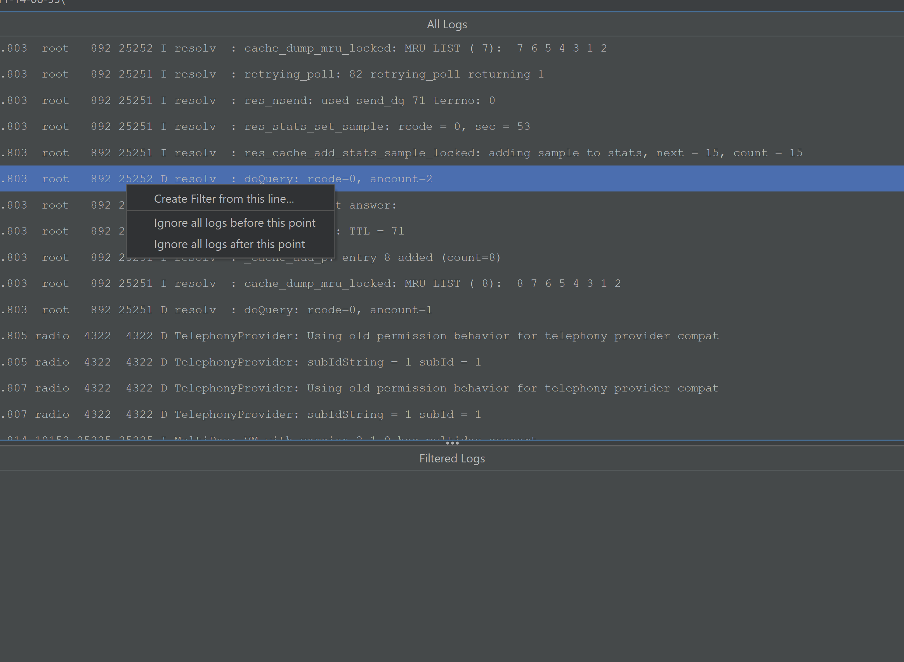
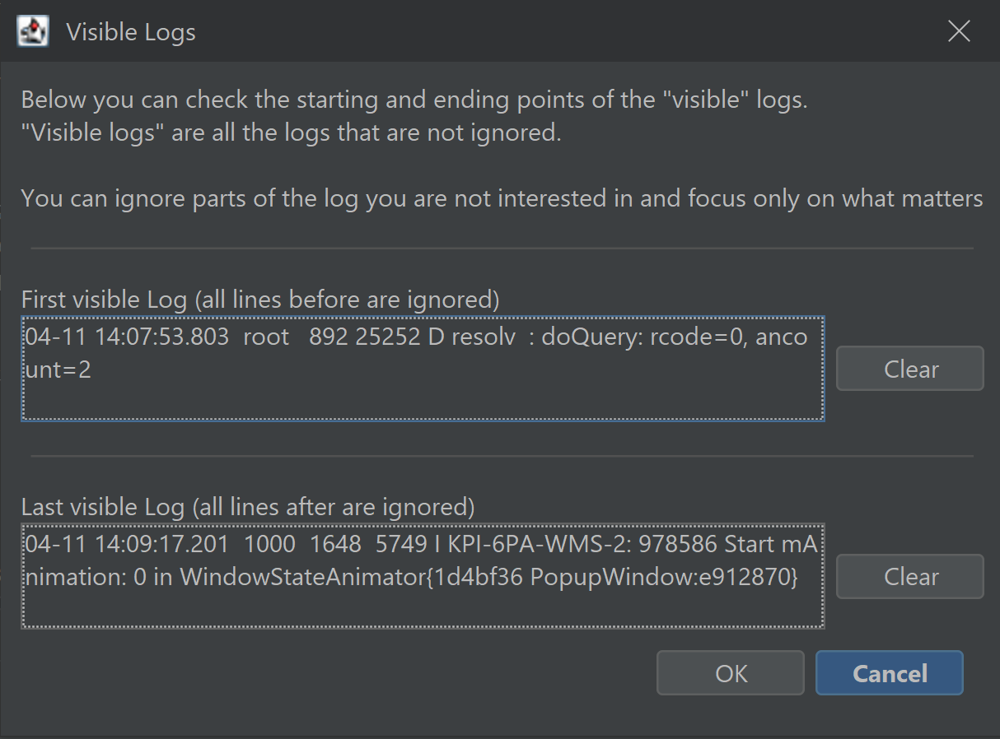
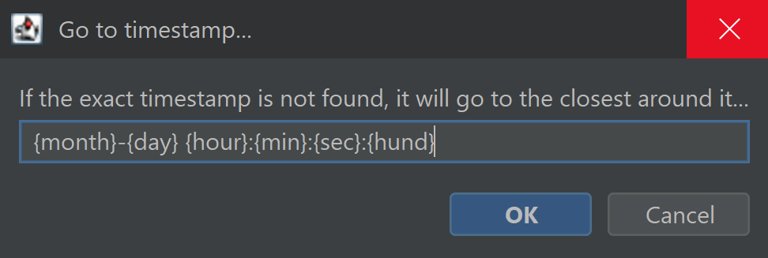

# Limiting Time Window

Heavy Android bugreports can span several days and contain millions of log entries. LogViewer makes it easy to isolate the exact time window of an incident and jump directly to specific timestamps.

---

## Restricting Visible Logs

You can define starting and ending thresholds to temporarily ignore logs outside your window of interest:

### 1. From the Context Menu
Right-click on any log line in the table to set boundaries:

* **Ignore logs before this line**: Hides all log entries that occurred earlier than the selected timestamp.
* **Ignore logs after this line**: Hides all log entries that occurred later than the selected timestamp.

### 2. From the Visible Logs Dialog
To review, adjust, or clear active time boundaries, go to `Logs > Visible Logs`:

* Click **Clear** next to the start or end threshold to restore the full log timeline.

---

## Jumping to a Timestamp

To jump directly to a known incident time:

1. Select `Logs > Go to Timestamp` from the menu bar or press ++cmd+g++ (macOS) / ++ctrl+g++ (Linux & Windows).
2. Enter the target timestamp. If a log line is currently selected, its timestamp will automatically pre-fill the dialog.
3. Click **Go** to immediately scroll to the exact log entry (or the closest subsequent log line if an exact millisecond match does not exist).
