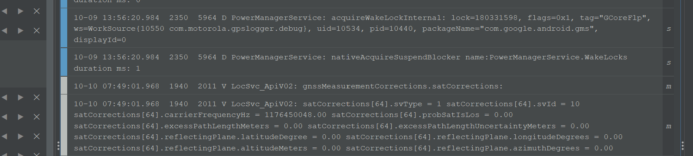
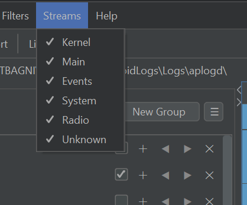

# Log Streams & Merging

Android segregates its log output into several dedicated buffers. LogViewer automatically identifies each stream when opening multi-file log dumps and merges them into a single chronological timeline.

---

## Recognized Log Streams

LogViewer automatically recognizes the standard Android log stream buffers:

* **`main`**: General application and user-space logging.
* **`system`**: Core framework, system services, and OS daemons.
* **`events`**: High-level binary event logs (window transitions, screen power, process lifecycle).
* **`radio`**: Cellular telephony, SIM card communications, and RIL events.
* **`kernel`**: Low-level kernel driver messages (`dmesg` / `/dev/kmsg`).

---

## Visual Stream Badges

When multiple log files with different streams are loaded together, each line in the log table displays a dedicated stream badge:

This allows you to immediately tell whether a log line originated from the system server, the radio daemon, or an application process.

---

## Toggling Streams in Filtered Output

When multiple streams are present, a **Streams** menu appears on the toolbar:

* Check or uncheck individual streams to include or exclude them from your filtered output.
* Stream toggles take effect instantly in memory without re-parsing files or re-running regex filters.
