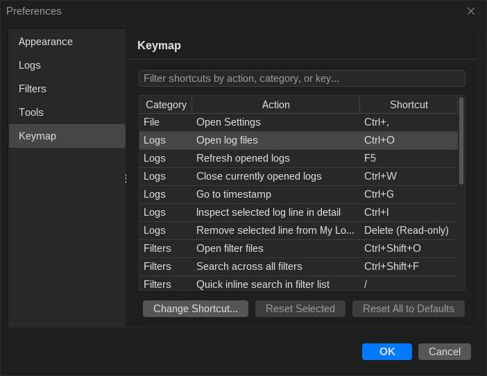

# Keyboard Shortcuts

LogViewer is built for rapid keyboard navigation during intense debugging sessions, and includes a customizable Keymap editor so you can tailor bindings to your workflow.

---

## Default Keyboard Shortcuts

| Category | Action | macOS | Linux & Windows |
| :--- | :--- | :--- | :--- |
| **File** | Open Settings | ++cmd+comma++ | ++ctrl+comma++ |
| **Logs** | Open log files | ++cmd+o++ | ++ctrl+o++ |
| **Logs** | Refresh opened logs | ++cmd+r++ | ++f5++ |
| **Logs** | Close currently opened logs | ++cmd+w++ | ++ctrl+w++ |
| **Logs** | Go to timestamp | ++cmd+g++ | ++ctrl+g++ |
| **Logs** | Inspect selected log line in detail | ++cmd+i++ | ++ctrl+i++ |
| **Logs** | Remove selected line from My Logs | ++delete++ | ++delete++ |
| **Filters** | Open filter files | ++cmd+shift+o++ | ++ctrl+shift+o++ |
| **Filters** | Search across all filters | ++cmd+shift+f++ | ++ctrl+shift+f++ |
| **Filters** | Quick inline search in filter list | ++slash++ | ++slash++ |
| **Filters** | Previous filter match in logs | ++comma++ (`<`) | ++comma++ (`<`) |
| **Filters** | Next filter match in logs | ++period++ (`>`) | ++period++ (`>`) |
| **Filters** | Toggle selected filter(s) on/off | ++space++ | ++space++ |
| **Filters** | Edit selected filter | ++enter++ | ++enter++ |
| **Filters** | Delete selected filter(s) | ++delete++ | ++delete++ |
| **Search** | Find in active log table | ++cmd+f++ | ++ctrl+f++ |
| **Search** | Next search match | ++f3++ / ++enter++ | ++f3++ / ++enter++ |
| **Search** | Previous search match | ++shift+f3++ / ++shift+enter++ | ++shift+f3++ / ++shift+enter++ |
| **Navigation** | Switch to Main Logs tab | ++cmd+1++ | ++ctrl+1++ |
| **Navigation** | Switch to Bug Report tab | ++cmd+2++ | ++ctrl+2++ |
| **Navigation** | Switch to Live Logs tab | ++cmd+3++ | ++ctrl+3++ |

---

## Customizing Shortcuts (Keymap)

You can view, search, and rebind keyboard shortcuts directly inside LogViewer by opening **File > Settings > Keymap** (or selecting **Help > Keyboard Shortcuts...** from the menu bar):

* **Instant Search**: Filter the shortcut table by category, action name, or key combination.
* **Rebind Any Action**: Double-click an action row (or click **Change Shortcut...**) and press your desired key combination. Customized shortcuts are highlighted in **bold**.
* **Conflict Detection**: LogViewer automatically checks for keybinding collisions within the same or global activation scope and warns you before overriding existing bindings.
* **One-Click Reset**: Restore an individual shortcut with **Reset Selected**, or revert all shortcuts to their platform defaults with **Reset All to Defaults**.
